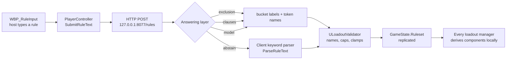

# Wishcraft: Design Document and Agent Brief

Codename: Wishcraft (final name undecided). Version 2.0, November 21, 2026.

Version 1.0 of this document was a plan. Version 2.0 is **as-built**: every statement in Sections 5 to 8 was read out of the source tree and the asset registry, not remembered from the plan. Where the build diverged from the plan, the divergence and its reason are recorded in Section 4 rather than quietly edited out, because the divergences are the most defensible part of the project. Section 9 says exactly what is verified and what is only compiled.

## 1. How to use this document

This is both the project documentation and the working brief for the AI coding agent. The agent must read it fully before writing code, treat Sections 5, 6 and 11 as binding, and ask before adding anything outside scope.

Two conventions used throughout:

- **As-built** means read from `Source/`, `Content/` or the editor. **Planned** means it exists only in the original design and has no code behind it. Nothing planned is described as if it exists.
- Anything measured has its figure and its measurement surface attached. Anything merely compiled says so.

## 2. Vision

**Pitch:** type a rule, and the match changes. A multiplayer arena game where abilities are built from a small closed vocabulary of tokens, and a purpose-trained language model turns plain sentences into changes to those tokens.

- The substance is the rule layer: text in, a validated change to a replicated ruleset out. The model is a friendly input method on top of it, and is deliberately the least trusted component in the system.
- The original inspiration is hero shooters such as Valorant and Marvel Rivals. The build target is a chaotic arena or party mode, not a competitive shooter (Section 4, decision 10).
- Most players will not write rules. Presets, random rolls and pickups matter as much as typed rules, and they come almost free once abilities are data.

## 3. Scope

| Area | Shipped now | Next |
| --- | --- | --- |
| Players | 2 on a listen server, direct IP, manual PIE setup | 4 to 8, dedicated servers, matchmaking |
| Abilities | 3 token rows: Fireball (Offense), Invisibility (Defense), SpeedBoost (Mobility) | More tokens; presets, pickups, random rolls |
| Input | Text panel to local model service to validator to replicated ruleset, plus console commands | Presets, mutators, checkbox UI |
| Camera | Third-person follow **or** a two-player framing camera, chosen per machine, defaults to shared | — |
| Modes | Free-for-all in one arena, first to 3 kills | Prop Hunt, team modes |
| Framework | Custom ability component | Possible migration to GAS |
| Balance | Not a goal | Tuning pass per token and parameter |

## 4. Key decisions and tradeoffs

Decisions 1 to 3 and 6 to 11 were made in the plan and held. Decisions 4, 5 and 12 changed during the build, and 13 to 15 were forced by reality.

| # | Decision | Reason | Cost or risk |
| --- | --- | --- | --- |
| 1 | Unreal Engine 5.8, C++ project, Blueprint subclasses for cosmetics only | Replication, base classes and the loadout manager are cleaner in C++. Blueprints are kept for VFX wiring, UMG and level actors | Slower iteration than pure Blueprint |
| 2 | No GAS in the prototype, custom ability component instead | GAS has a steep learning curve; the hand-rolled version is small and the developer can explain every line | Activation, cooldown and tag logic are hand-rolled. Mitigation: abilities are data, so a migration starts from the token table |
| 3 | Abilities are data rows, not classes | One `UAbilityTokenTable` row plus one component class is a complete ability. Adding a fourth ability is a data edit and a keyword list, no new subsystem | A new *behaviour* still needs a component class. Non-hero combinations do not exist yet, because the composition model was never built (decision 12) |
| 4 | **Changed:** the single replicated source of truth is the GameState's ruleset, not the PlayerState's | The GameMode is server-only and cannot own state clients need. The GameState replicates to everyone, which makes it the natural owner of "the rules of this match". A replicated per-player loadout meant every controller had to be pushed to individually | Each player's `UAbilityLoadoutManager` holds a local *mirror* and derives its own components. Server and client must derive identically, so the derivation lives in one function |
| 5 | **Changed:** the intent layer is a locally served, purpose-trained model, not a hosted LLM | Removes latency, cost, nondeterminism and API-key handling entirely; the vocabulary travels in the request body so a new token needs no redeploy | The model is narrow by construction (it labels, it never produces a value) and must run as a local service. It is also, structurally, the weakest layer, which is why it sits third of four |
| 6 | One data-driven validator runs before anything spawns | Model output is untrusted. Conflict rules live in one place | None worth naming; this held exactly as planned |
| 7 | Listen server with direct IP | No infrastructure to build | Host advantage, NAT problems, no matchmaking. Match scores are server-only and are not on the HUD for this reason |
| 8 | Niagara per token, plus character-level hit, death and spawn feedback | Keeps quality and performance controllable while staying modular | Effects must be capped before more tokens are added |
| 9 | Free-for-all only | Smallest mode that shows the system | Prop Hunt deferred |
| 10 | Competitive balance is not a goal | Open combinations conflict with learnable fixed kits | Not suited to esports-style play |
| 11 | Use the experimental Unreal MCP plugin for editor automation | Lets the agent drive the editor | Experimental and flaky; it has already cost one asset (Section 11) |
| 12 | **Changed:** no element/role/delivery/shape recipe. One flat token table with a category | The composition model (144 combinations) was the plan's biggest promise and also its biggest cost: a validator, a balance problem and a generic-VFX problem, all before the demo worked. The token table proves the same idea — text in, validated data change out — with a fraction of the surface | The "combinatorial" pitch is weaker. Abilities are three fixed behaviours, not 144 recipes. Element data, delivery behaviours and shape geometry do not exist |
| 13 | **Added:** the camera mode is a per-machine preference on the PlayerController, never replicated | Each player picks their own view and may disagree. On the controller rather than the pawn so a respawn does not reset it. Defaults to the shared camera | Two machines can be in different camera modes, so movement has to build its basis from the live view target rather than from control rotation |
| 14 | **Added:** the third-party framing camera is a project plugin, wired as a camera *mode* | It was built independently as a Naruto-Storm-style two-player framing rig and brought in as-is | It is a real dependency (`Plugins/SharedCameraSystem`) and it frames only when the pair is close (it halves distance / 1200) |
| 15 | **Accepted:** there is no version control repository | None was ever initialised | Nothing can be restored. This project has already lost an asset's source twice. See Section 11 |

## 5. Ability model (as built)

### 5.1 The token table

`UAbilityTokenTable : UPrimaryDataAsset`, asset `/Game/Sandbox/DA_AbilityTokens`. One property, `TMap<FName, FAbilityTokenDefinition> Tokens`. It is the single source of truth for what the rule layer may grant: the validator reads it, the loadout manager reads it, the model service is sent it, and every client that has to render another player's effect loads it through the static `GetDefaultTable()` accessor.

One row (`FAbilityTokenDefinition`) is:

| Field | Meaning |
| --- | --- |
| `DisplayName` | `FText` used in validation messages |
| `Category` | `EAbilityCategory`: Offense, Defense, Mobility |
| `ComponentClass` | `TSubclassOf<UAbilityComponentBase>`, spawned locally on every machine when equipped |
| `DefaultParams` | `TMap<FName, float>` |
| `ParamRanges` | `TMap<FName, FAbilityParamRange>` — Min, Max, Default per parameter |
| `Keywords` | `TArray<FString>` the parser and the fallback look for |
| `StartEffect`, `SustainEffect`, `EndEffect` | optional `UNiagaraSystem` |
| `StartSound`, `SustainSound`, `EndSound` | optional `USoundBase` |
| `AttachSocket`, `EffectOffset` | where cosmetics attach (default `hand_r`) |

### 5.2 The three rows that ship

| Token | Category | Parameters (default, range) | Socket | Cosmetics |
| --- | --- | --- | --- | --- |
| `Fireball` | Offense | `Damage` 20 (5–100); `ProjectileSpeed` 2500 (800–5000); `Cooldown` 1.5 (0.2–10) | `hand_r` | start only: `NS_Ability_FireballCast` + `SFX_Ability_FireballCast`; the impact, trail and hit flash are handled by the projectile and the character, not the token row |
| `Invisibility` | Defense | `Duration` 5 (1–15); `Cooldown` 8 (0.5–30) | `spine_03` | start **and** end: `NS_Ability_InvisibilityPulse` + `SFX_Ability_InvisibilityOn` / `Off`. Sustain is deliberately empty, because a looping aura would outline a player who is supposed to be invisible |
| `SpeedBoost` | Mobility | `Duration` 5 (1–15); `Multiplier` 1.6 (1.05–3.0); `Cooldown` 6 (0.5–30) | `None` (mesh origin) | sustain only: `NS_Ability_SpeedTrail` + `SFX_Ability_SpeedLoop` |

Keyword lists, as shipped (12 / 13 / 12):

- **Fireball:** fireball, fireballing, fire, ball of fire, blast, shoot, shooting, projectile, ranged, attack, nuke, offense
- **Invisibility:** invisibility, invisible, vanish, unseen, ghost, cloak, cloaked, camouflage, sneak, stealth, stealthy, disappear, hide
- **SpeedBoost:** speed, speedy, boost, haste, hasty, fast, sprint, running, zoom, velocity, turbo, mobility

Two names that the intent corpus can produce and the game cannot honour: **LightningStrike** and **Shield** have no token row and no class. They exist only in the model's vocabulary and in generated test sentences. The measurement handles them explicitly (Section 8.5) rather than pretending they resolve.

### 5.3 Validity rules (data, not code)

`ULoadoutValidator` is the only path from tokens to a live loadout. `ValidateTokens` and `ValidateIntentJson` share it wholesale.

1. No table loaded → rejected.
2. Unknown token → rejected, with the full known list in the message.
3. Category cap exceeded → rejected. **Defense is capped at 1; Offense and Mobility are not capped (99).**
4. Token listed twice → rejected by name.
5. Anything that survives is turned into `FAbilitySpec` with every parameter **clamped** against `ParamRanges`.

Every rejection carries a plain-English sentence, because the panel shows it to the host.

## 6. Architecture (as built)

### 6.1 Types

`Source/WishCraft/Abilities/AbilityTypes.h`:

- `EAbilityCategory` — Offense, Defense, Mobility.
- `FAbilityParamRange` — Min, Max, Default, with `ClampValue`.
- `FAbilityTokenDefinition` — the table row above.
- `FAbilityParam` — `FName` + `float`. **Deliberately a pair, not a map entry:** `FMapProperty::NetSerializeItem` refuses replicated TMaps and serialises nothing, so a map here would arrive empty on every client.
- `FAbilitySpec` — `FName Token` + `TArray<FAbilityParam> Params`. This is what replicates. Convenience `GetParam` / `SetParam` / `ToParamMap`.
- `FAbilityState` — `Token`, `LastActivationServerTime`, `bActive`. This is what a client derives cooldown from.

### 6.2 Runtime classes

| Class | Lives on | Job |
| --- | --- | --- |
| `AWishCraftGameState` | GameState | Replicated `TArray<FAbilitySpec> Ruleset` with `OnRep_Ruleset`. `ServerSetRuleset` and `BroadcastRulesetChanged` are server-only |
| `UAbilityLoadoutManager` | PlayerController, constructor subobject | Local mirror of the ruleset; derives and owns this pawn's `UAbilityComponentBase` components; `ServerSetLoadout`, `ServerSetIntentJson`, `RequestSetLoadout`, `RequestActivateCategory` / `Token`, `GetCooldownRemaining`, `IsTokenActive` |
| `AWishCraftPlayerController` | PlayerController | Owns `ApplyRuleText`, `SubmitRuleText` (async model request), `OnRuleResolution`, `bRuleRequestPending`, `bPrefersSharedCamera`, and the exec commands `Rules`, `RulesModel`, `RulesRaw`, `RuleUI` |
| `AWishCraftCharacter` | Pawn | Health, invisibility flag, ability cosmetics, hit / death / spawn feedback, camera preference application, move and look |
| `AAbilityProjectile` | Spawned actor | Travelling projectile; carries its token, applies damage on the server, configures its own cosmetics |
| `UAbilityComponentBase` + `UAbility_Fireball`, `_Invisibility`, `_SpeedBoost` | On the pawn, locally | One per equipped token. `BeginEffect` / `EndEffect`, parameter map, activation |
| `UHealthComponent` | On the pawn | Health, `OnHealthChanged`, death broadcast |
| `UAbilityTokenTable` | DataAsset | Section 5.1 |
| `ULoadoutValidator` | Function library | Section 5.3 |
| `URuleParserLibrary` | Function library | Deterministic keyword parser, used as the fourth answering layer and as the offline stand-in |

### 6.3 The path a sentence takes



Two invariants hold at every step:

- **The model never produces a gameplay value.** It returns *bucket labels* only — `much_lower`, `lower`, `default`, `higher`, `max` — and the C++ validator maps each label through the token's authoritative range and clamps it. The service is never sent a min or a max, and cannot multiply.
- **Nothing spawns without the validator.** Both the UI path and the model path go through `ULoadoutValidator`; the client fallback does too.

### 6.4 Camera

`Plugins/SharedCameraSystem` provides `ASharedCameraManager : APawn` and `USharedCameraComponent : UActorComponent`. One manager is placed at the origin in `Lvl_Arena` as `BP_SharedCameraManager_Child`. The component is on the combat character Blueprint **class**, and reaches the manager in `USharedCameraComponent::BeginPlay` with `GetActorOfClass`, on the authority only.

**It is a camera mode, not the camera.** `AWishCraftPlayerController::bPrefersSharedCamera` defaults to `true` and is deliberately **not replicated**: two players may want different views. `AWishCraftCharacter::ApplyPreferredCamera` is the only place in the project that calls `SetViewTarget`, it runs from `NotifyControllerChanged` (the one hook that fires after possession on both machines), and it retries on a 0.1 s timer because the manager is a separate replicated actor that can arrive late. `IA_ToggleCameraMode` (F3) flips the local preference.

Consequence: `DoMove` builds its basis from `GetPlayerViewPoint` while the manager is the view target, and `DoLook` returns early in that mode. Never test shared mode with the flag — test the live view target.

### 6.5 Match flow and UI

`AWishCraftGameMode` (abstract, Blueprint-subclassed): `ScoreLimit` 3, `RespawnDelay` 2 s, `bMatchOver`, `HandlePlayerDeath`, `RespawnPlayer`, per-controller `Scores`. Scores and `bMatchOver` are **server-only and unreplicated**, which is why the match HUD is not on the client's screen.

Widgets in `/Game/Sandbox/UI`: `WBP_RuleInput` (host rule entry, Enter commits), `WBP_LoadoutReadout` (what is equipped and what the model answered), `WBP_HealthBar` (per-player).

### 6.6 Input

`IA_Move`, `IA_Look`, `IA_MouseLook`, `IA_Jump`, `IA_Ability_Offense`, `IA_Ability_Defense`, `IA_Ability_Mobility`, `IA_RuleInput`, `IA_ToggleCameraMode`, under `IMC_Default` and `IMC_MouseLook`.

## 7. Networking rules (as built)

- The server decides activation, damage, status effects and cooldown validity. Clients only request.
- **Replicate the spec list, not the components.** `AWishCraftGameState::Ruleset` is the single replicated truth; components are derived locally from it on every machine.
- Cooldowns are one `LastActivationServerTime` per token; remaining time is derived locally. No replicated countdown.
- Cosmetics go out as a `NetMulticast, Reliable` on the character (`MulticastAbilityEffect`), not on the caster's component, because **a machine that does not own the character has no ability component to notify** — that was the bug that made the other player's abilities invisible.
- Replicated structs carry arrays, never `TMap`.
- Cosmetics that are local reactions (`OnHealthChanged`) use the existing `OnRep` rather than adding a second replication path.
- Test every ability with two clients. Two-player PIE is **manual**: Play dropdown, Number of Players = 2, Net Mode = Play As Listen Server. `ULevelEditorPlaySettings` is not exposed to Python.
- Verify engine API names against the 5.8 source. Do not rely on memory.

## 8. The intent layer (as built)

### 8.1 Shape

`Tools/intent_model/` — a small purpose-trained transformer served by FastAPI on `127.0.0.1:8077`. Start it with `Saved/run_service.bat` **before any PIE test**, or every rules box silently falls through to the keyword parser and reads as a model failure.

```
POST /rules
{"text": "...", "tokens": [{"name": "Fireball", "keywords": [...]}, ...]}
-> {"tokens": [{"name": "Fireball", "params": {"Damage": "higher"}}]}
```

The catalogue arrives in the request body, so the service holds no ability table of its own: **adding a fourth ability is a game-side data change**, with no redeploy and no checkpoint change. The response is bucket labels and nothing else. When nothing clears the confidence floor the response is an empty list, which is the signal to fall back.

The answering layer is reported in the `X-Intent-Source` response header (`exclusion` / `clauses` / `model` / `no-catalogue`) rather than in the body, because the body's shape is load-bearing: the controller and the validator both require exactly one root field.

### 8.2 Four layers, in order

| Layer | What it answers | Why it is not the model's job |
| --- | --- | --- |
| 1. Exclusion (`exclusion.py`) | "without the fireball" | That is label *subtraction*. Every forward-reading path equips the fireball instead — both the model and the keyword parser scored 0 on the exclusion families |
| 2. Clauses (`clauses.py`) | "shorter cooldowns and heavier fireballs" | Two parameters at once. Three training runs could not teach it in the weights; the model binds one adjective and drops the other |
| 3. Model | everything else | This is the actual language understanding |
| 4. Client keyword parser (`URuleParserLibrary`) | an empty answer from layer 3 | The last resort, and the only layer that can invent a token by naming it |

### 8.3 Measured

Corpus v3, floor 0.50, served vocabulary (the 12 / 13 / 12 keyword lists the game actually sends):

| Path | Rows | Token set | Intent |
| --- | --- | --- | --- |
| keyword baseline | 588 | 0.617 | 0.362 |
| model alone | 588 | 0.660 | 0.417 |
| service (4 layers, measured) | 588 | 0.935 | 0.923 |
| **as played** | 588 | 0.942 | **0.930** |
| **as played, expressible** | 578 | 0.958 | **0.946** |

Bucket accuracy 0.996. Exclusion 143/143. Clauses 221/221. `undetermined` 0 of 588. Ceiling 1.000.

### 8.4 Residual

45 wrong of 588 (35 wrong of the 578 real rows): 38 wrong token sets, 7 wrong buckets. Ten of the 38 are unanswerable — six `exclude_without` and four `exclude_all_but` sentences that name only `LightningStrike` or `Shield`, which the shipped three tokens cannot express. Of the 35 real misses, every one is a **name missing from a terse list** (`allow_terse` 12, `request_can_we` 9, `only_prefix` 6, `category_verb` 1), with exactly one invention left.

### 8.5 Rules for quoting these numbers

- Always quote the floor **and** the vocabulary. Neither figure means anything alone.
- Never diff across corpora: v3 changed the sentence generator, so every row re-renders.
- Judge on `test.jsonl` and `golden.jsonl`, never `valid.jsonl`.
- The unanswerable rows are reported as their own subset (`unshippable()` in `measure_clauses.py`). Restricting the generator's candidate list was rejected: it re-renders all four splits, moves both test hashes, and voids every published number for ten rows no rule or model change could answer.
- **Never trust a file that looks like the served config.** The DataAsset drifted from the catalogue twice. Derive the served lists in code (`measure_clauses.served_catalogue()`) and verify them against `DA_AbilityTokens`.

## 9. Status

### 9.1 Built and working

52 recorded phases in `Docs/BuildJournal.md` (P1 to P51 plus four addenda). The load-bearing ones:

- Listen server, replicated ruleset on the GameState, per-player derived components.
- Three tokens with parameters, ranges, cosmetics, audio and a single validator.
- The four-layer intent path, proven **in the client** rather than only on the measurement rig.
- Loadout readout and rule input widgets.
- Two camera modes, chosen per machine, defaulting to the shared framing camera.
- Cosmetic pass: hit flash, camera shake, projectile impact, death dissolve, spawn-in, health bar, velocity-oriented impact sparks.

### 9.2 Verified, and how

| Claim | Evidence class |
| --- | --- |
| Rules reach both machines | Verified in a two-player PIE session |
| Camera mode is per machine and defaults to shared | Verified in a two-player PIE session |
| Intent path works from the panel | Verified in a two-player PIE session, layer name in the log |
| Fireball impact path resolves after the asset rename | Verified from a cold editor launch (CDO read back after a full rebuild) |
| Cosmetic pass | **Asset readback, CDO reflection and compile status only. Nothing in the pass has been observed running.** |

That last row is the honest state of the project: the cosmetic work is built, wired and compiled, and it is unjudged. Two-player PIE, with the model service running, is the only thing that can judge it.

### 9.3 Remaining

1. Watch the cosmetic pass in two-player PIE.
2. Version control. There is none, and the project has lost an asset's source twice.
3. `Docs/IntentModelTutorial.md` stops at PART 8.16 (P39/P40); P41–P44 were never written up.
4. Arena dressing — the floor is still blockout material.
5. Match HUD (scores), blocked on replicating `Scores` / `bMatchOver` off the GameMode.
6. `NS_Death_Dissolve` has no dark smoke layer; there is no translucent material in the VFX folder.

## 10. Demo and portfolio

- A 60 to 90 second clip: the host types a rule, the match changes live, two players fight. Shoot it in the shared camera — it is the framing the gameplay was built around.
- A short architecture diagram: text, service, four layers, validator, replicated ruleset, locally derived ability. Section 6.3 is that diagram.
- A README that leads with the netcode and the rule layer, then the model.
- The build journal is the decision log. Every entry ends with an evidence class, so an interviewer can ask "how do you know" about any line and get an answer.

## 11. Agent working rules

- Finish and test each step with two clients before starting the next.
- Keep abilities data-driven. A new ability is a token-table row plus a component class, not a new subsystem.
- Ask before adding any feature outside this document.
- After each networking decision, append a short note to `Docs/BuildJournal.md` explaining what was chosen, what was rejected and why. Every entry ends by naming its evidence class.
- Keep code readable. The developer must be able to explain it.
- Prefer small, compiling changes over large rewrites.

### 11.1 Traps this project has already paid for

- **A hardcoded asset path is a string, not a reference.** `ConstructorHelpers::FObjectFinder` and `LoadObject` do not follow a rename or a delete, and a miss is a **startup log warning, not a compile error** — the effect vanishes silently on the next launch. `AAbilityProjectile` still names its impact system by literal, in two places.
- **Live Coding patches function bodies only.** A constructor literal reports `Patching Status: Succeeded` and leaves the CDO stale. Verify with `get_default_object` + `get_editor_property`, rebuild, then read again.
- **Existence is not resolvability.** `does_asset_exist` true with `load_asset` returning `None` is a stale package left by a rename. Both packages can be on disk with an object behind only one.
- **A running editor masks a dead path,** because its CDO still holds the previously loaded UObject.
- **Never call `replace_emitter` or `build_system` on a Niagara asset in this project.** Both report success while hollowing the asset and stripping it from disk. That is how the impact effect's source was lost once.
- **`bAutoDestroy` is not a promise the system ends.** A looping system never completes, so its component stays attached and re-bursts. That was a repeating flash on the character.
- **`rebuild_and_restart_editor`'s PIE guard reads a different flag than `is_in_play_in_editor()`.** It refuses while `LevelEditorPlaySettings` thinks a session is live; end play explicitly, then rebuild.
- **Additive materials ignore particle alpha.** Any fade must multiply RGB as well as alpha.
- **There is no git.** Anything destructive or bulk is unrecoverable; never run one without a backup.

## 12. Risks

| Risk | Likelihood | Mitigation |
| --- | --- | --- |
| The cosmetic pass has never been seen running | High — it is the current state | One two-player PIE session with the service running |
| No version control; second asset loss would be unrecoverable | Medium | Initialise a repo before any further asset surgery |
| Replication bugs returned with every new cosmetic path | Medium | Server-authoritative pattern, multicast from the character, test with two clients each time |
| The MCP plugin is flaky and has already cost an asset | Medium | Back up before bulk asset work; fall back to C++ and manual Blueprint edits |
| Model service not running during a demo | High, and it fails silently | `Saved/run_service.bat` first; check `GET /health`; the log names the answering layer |
| Scope creep | High | The cut list, and ask first |
| Arena looks like a blockout in the portfolio clip | High | Section 9.3, item 4 |
| Demand for typed rules is low | Medium | Presets and random rolls, cheap because abilities are data |

## 13. After the prototype

- Random loadout roll and preset mutators (cheap, since abilities are data).
- Collectible pickups that grant tokens.
- Replicate match scores so the HUD can show them.
- More tokens, and with them the first real test of whether the vocabulary generalises.
- Evaluate migrating to GAS for tags, attributes and prediction.
- Prop Hunt, reusing the same rule layer for mode settings.
- A balance pass if a competitive angle is ever pursued.

## 14. Open questions

- Final name. Wishcraft already exists as a game on itch.io, so treat it as a codename.
- Whether the composition model (element, role, delivery, shape) is worth reviving once the three tokens are solid, or whether the flat token table is the better long-term shape.
- Whether invisibility belongs in the first public build, given that a two-player framing camera makes a hidden player hard to read.
- How far the token vocabulary can grow before the model's residual becomes the thing players notice.
